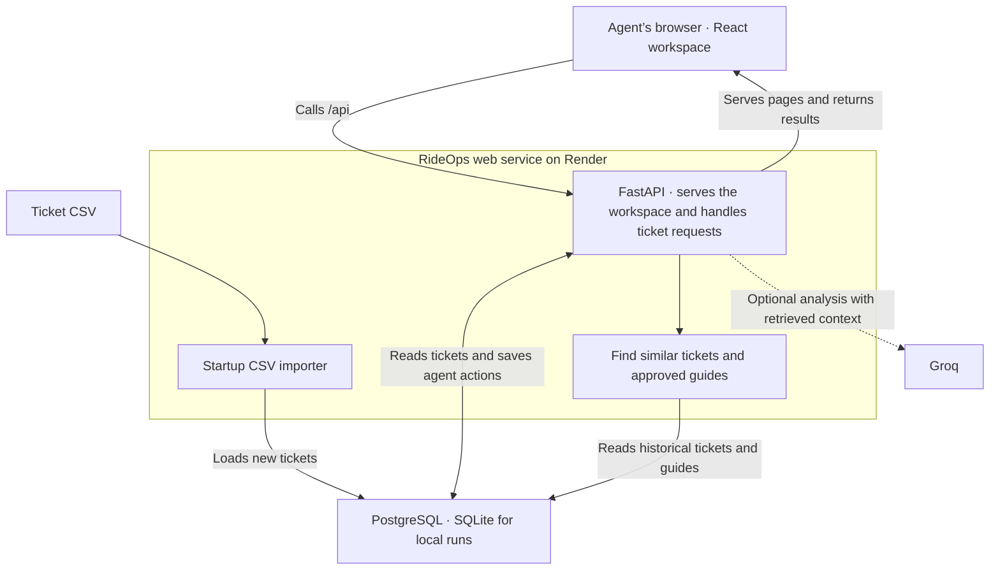
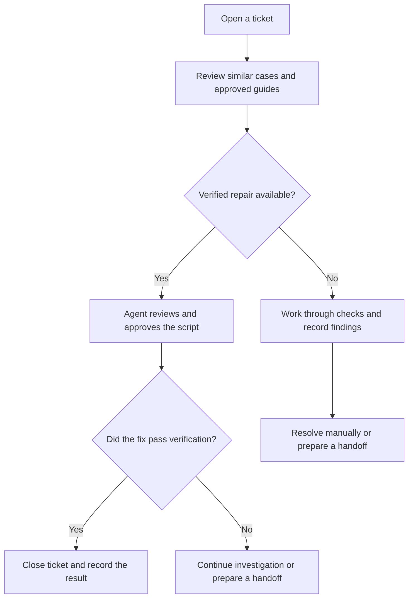

# RideOps Resolve

RideOps helps first-line support agents solve employee transport issues before passing them to engineering. In the case study, engineering returned **173 of 486 escalations** to support. RideOps gives agents approved guides, similar tickets and a way to verify a fix.

[Open the live demo](https://rideops-resolve.onrender.com/)

## Architecture



## How a ticket gets resolved



**Try it:** In **Resolve Ticket**, open **SUP-11422** → **Analyse with AI** → **Review verified script** → **Approve and run**. The repair updates a demo roster, checks its cutoff and closes the ticket. Try **SUP-11438** to see how a missing cutoff keeps the ticket open.

Use **Dashboard** for trends and ageing tickets, **Tickets** to search the queue, and **Knowledge Bank** to review or approve guides.

## Run locally

Install **Python 3.12+** and **Node.js 22 with npm**. From the project folder, run:

```sh
python3 start-local
```

Open the address printed in your terminal. On Windows, use `py -3 start-local`. Built-in checks work without an API key.

<details>
<summary>Optional setup and project files</summary>

- **Groq:** Copy `.env.example` to `.env`, set `GROQ_API_KEY`, then restart. Use `GROQ_MODEL` to change the model.
- **PostgreSQL:** With Docker running, use `docker compose up --build -d --wait` and open [localhost:3000](http://localhost:3000). Stop with `docker compose down`.
- **Semantic search:** Keyword search is the default. To enable Chroma with Sentence Transformers, install [the optional dependencies](backend/requirements-semantic.txt) in the backend environment and set `RIDEOPS_EMBEDDING_MODEL` to a local model directory.
- **Files:** [Frontend](frontend/) · [Backend](backend/app/) · [Ticket dataset and field dictionary](data/) · [API tests](backend/tests/)

</details>
